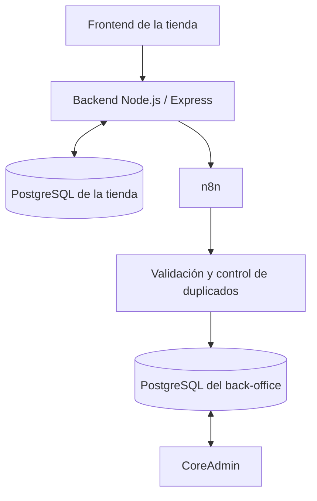

# Arquitectura del sistema

## 1. Arquitectura general

El sistema está compuesto por una tienda online y un back-office independiente, conectados mediante una automatización desarrollada con n8n.

La arquitectura utiliza dos bases de datos independientes para separar la información de ambos sistemas.

## 2. Componentes principales

- **Frontend:** interfaz web utilizada por los clientes para consultar productos y realizar pedidos.
- **Backend:** gestiona la lógica de negocio, valida las operaciones y se comunica con la base de datos.
- **PostgreSQL de la tienda:** almacena los datos propios de la tienda.
- **n8n:** recibe los eventos del backend, valida la información y automatiza su transmisión al back-office.
- **PostgreSQL del back-office:** almacena de forma independiente los pedidos recibidos, sus líneas y los registros necesarios.
- **CoreAdmin:** aplicación administrativa que permite consultar y gestionar pedidos, incidencias, indicadores y registros.

## 3. Flujo de comunicación

Cuando un cliente realiza un pedido, el backend lo registra en la base de datos de la tienda y genera un evento `order.created`.

A continuación, n8n recibe el evento y realiza las siguientes operaciones:

1. Valida los datos recibidos.
2. Normaliza la información.
3. Comprueba que el pedido no esté duplicado.
4. Registra el pedido y sus líneas en la base de datos del back-office.
5. Registra el resultado de la ejecución.

Finalmente, CoreAdmin consulta la información almacenada y permite gestionarla desde su interfaz administrativa.

## 4. Separación de sistemas

La tienda y el back-office mantienen bases de datos independientes. Ninguno necesita acceder directamente a la base de datos del otro.

La comunicación se realiza mediante eventos y automatizaciones, lo que permite mantener separados ambos sistemas y controlar el intercambio de información.

## 5. Tecnologías utilizadas

| Tecnología | Función |
|---|---|
| React y Vite | Interfaces web |
| Node.js y Express | Backend y API |
| PostgreSQL | Bases de datos |
| n8n | Automatización e integración |
| Recharts | Gráficos del dashboard |
| Git y GitHub | Control de versiones |

